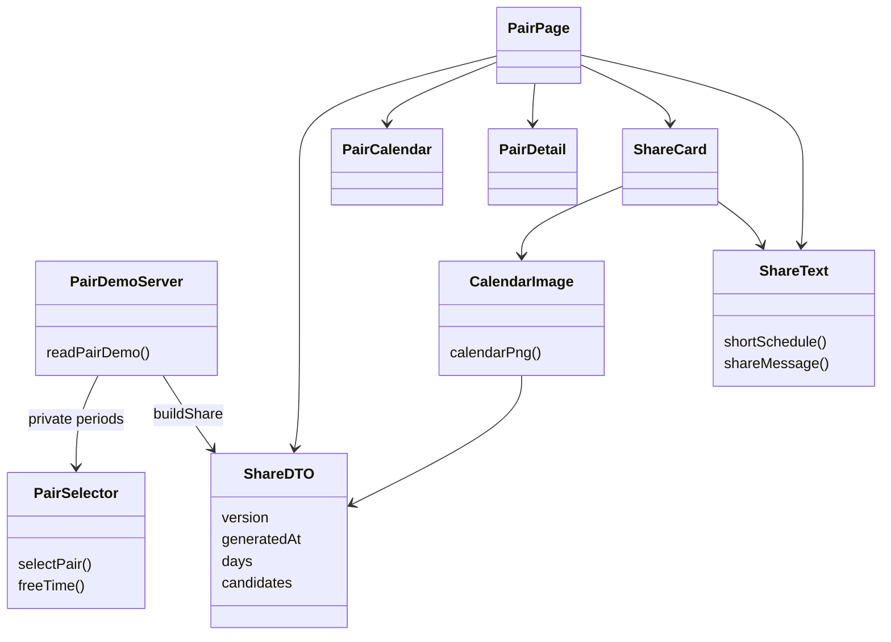
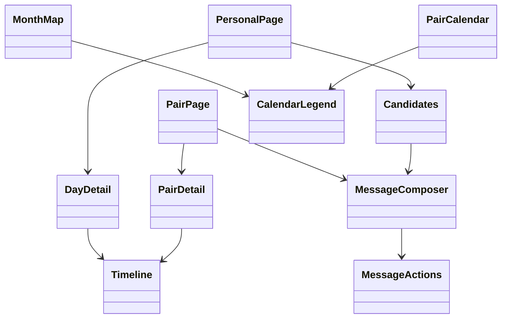
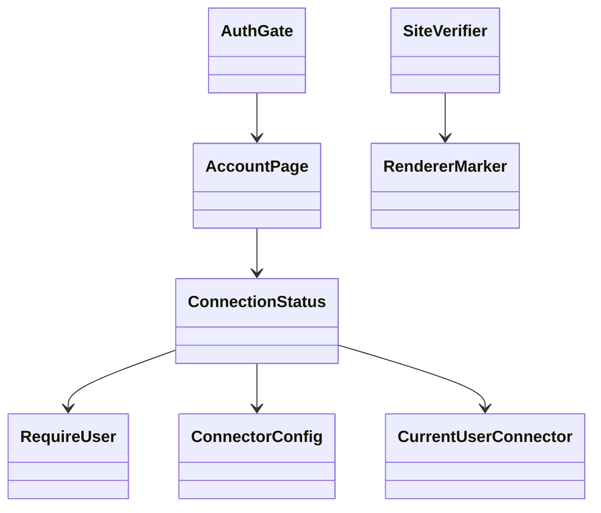
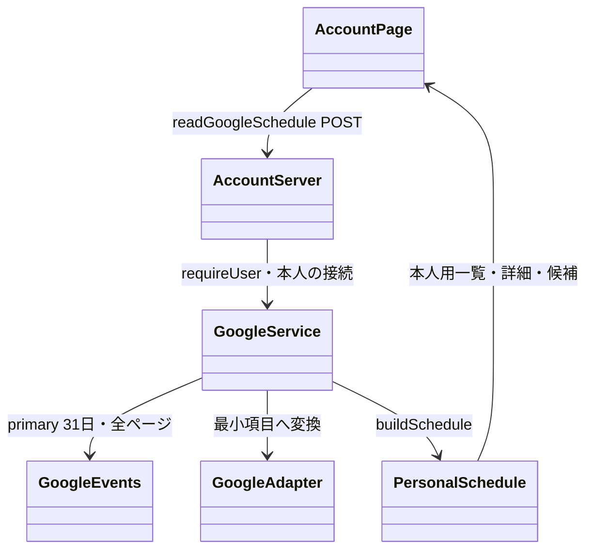
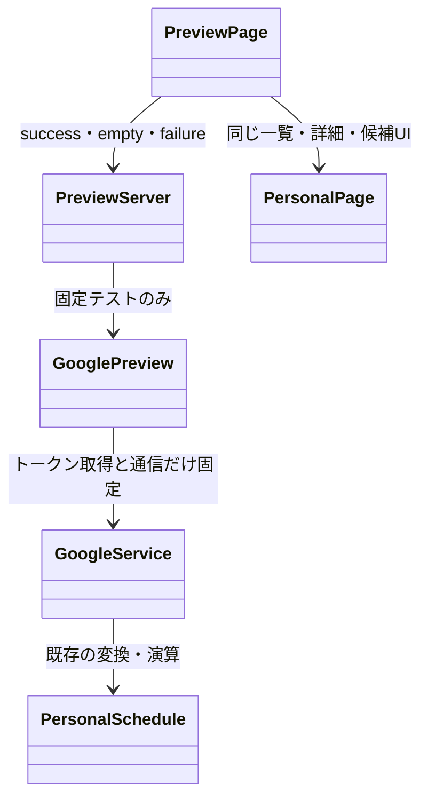
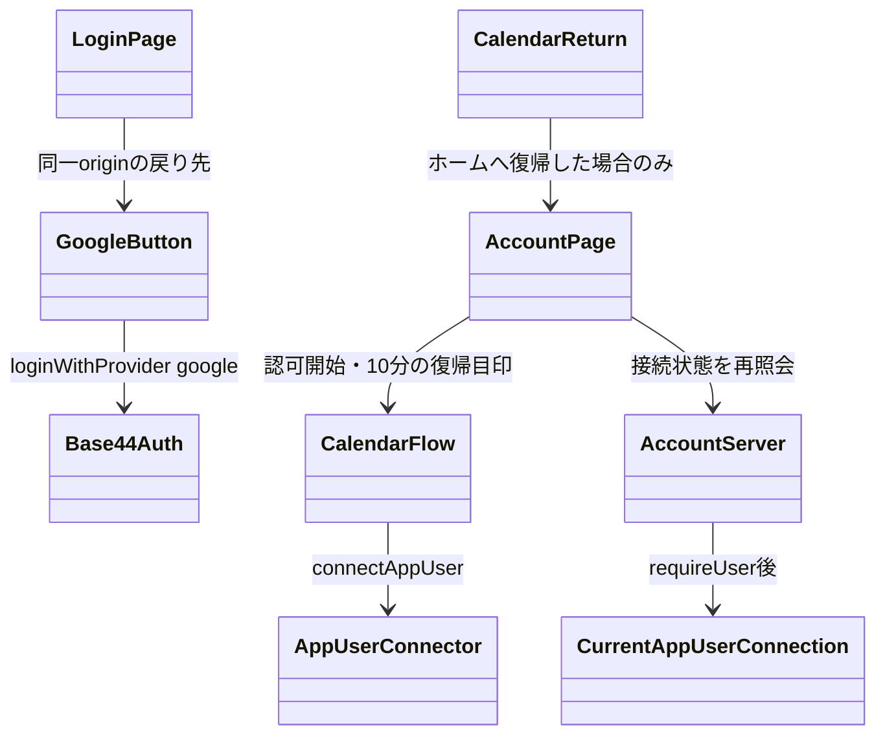

# リスケRisukeアーキテクチャ

更新日：2026-10-18。全体構造の正本。クラスは論理モジュールを表す。実装状況は[機能一覧](docs/spec/features.md)、詳細な入出力は[契約](docs/spec/contracts.md)を参照する。

## 1 方針と資料の分担

- 初版は本人の芝・時間別詳細・候補日・共有画像保存・LINEカード自動生成と固定版リンク共有。将来機能とUIのみの機能を実行対象に混ぜない。
- 計算は純関数。日時・調整の仮ルールは交換可能にし、意味・単位・未取得の表現を境界で固定する。
- 受付と実行を分離する。queuedは耐久的に受け付けた状態であり、単にDBへ書くだけで自動実行されるとは扱わない。
- 本人用は最新の完成版、共有用は依頼時の固定版。計算途中をUI・共有へ渡さない。
- 標準User＋7エンティティの既存草案に、画像・カード参照の保存設計を追加する。具体的スキーマ拡張はP13。DBのロック・一意制約・複数レコードの原子性は前提にしない。
- 認証・所有者・共有許可をサーバーで検証する。秘密・予定名・本文は表示・ログへ出さない。

| 内容の正本 | 資料 |
| --- | --- |
| 範囲・実装状況 | [機能一覧](docs/spec/features.md) |
| 操作・画面 | [外部設計](docs/spec/external.md) |
| 受付・実行・更新経路 | [内部設計](docs/spec/internal.md) |
| 関数・日時・仮ルール・表示用データ | [契約](docs/spec/contracts.md) |
| 保存・関連 | [DB草案](docs/spec/schema.md) |
| 状態・コード・ログとDBの対応 | [ログ仕様](docs/spec/logs.md) |
| 権限・受入条件・未決 | [権限表](docs/spec/access.md)／[確認リスト](docs/spec/checks.md)／[判断待ち](docs/spec/decisions.md) |

## 2 クラス図

~~~mermaid
classDiagram
    direction TB
    class WebUI {
        +showStatus(runId)
    }
    class FeatureGate {
        +resolveMode(feature)
    }
    class LineReceiver {
        +verifySignature(body)
        +identifyCommand(event)
    }
    class RequestReceiver {
        +enqueue(request) RunId
    }
    class JobQueue {
        <<基盤は判断待ちP05>>
        +accept(request) RunId
        +claim() Job
    }
    class Worker {
        +process(runId)
    }
    class UpdateController {
        +process(run)
    }
    class CalendarAdapter {
        +fetch(range, timezone)
    }
    class EventNormalizer {
        +normalize(rawEvents)
    }
    class AdjustmentApplier {
        <<契約詳細は判断待ちP01>>
        +apply(events, adjustments)
    }
    class DayAggregator {
        +calculateDaily(events, options)
        +calculateHourly(events, options)
    }
    class Recommender {
        +select(daily, options)
    }
    class TimeAdapter {
        <<仮ルールを交換>>
        +resolveDates(input)
    }
    class Store {
        +saveSnapshot(run, result)
        +publish(owner, snapshotId)
        +readPublished(owner)
    }
    class ViewAssembler {
        +buildPersonal(snapshot)
        +buildShare(snapshot, permission)
    }
    class ShareImageRenderer {
        <<WebUIの共有部分のみ>>
        +render(snapshot)
    }
    class ImageStore {
        <<保存と配信用URLはP13>>
        +save(snapshotId, image)
    }
    class CardAssembler {
        +build(savedSnapshot, savedImage, copyTemplate)
    }
    class ShareReader {
        +read(token)
    }
    class LineSender {
        +reply(token, messages)
    }
    class User
    class UserProfile
    class CalendarSource
    class ManualAdjustment
    class AvailabilitySnapshot
    class GroupPermission
    class ShareSnapshot
    class OperationRun

    WebUI --> FeatureGate
    FeatureGate --> RequestReceiver : 実行対象のみ
    LineReceiver --> RequestReceiver : 署名と依頼を検証後
    RequestReceiver --> JobQueue : 本人と入力とモードを検証
    RequestReceiver ..> OperationRun : 受付の記録
    JobQueue --> Worker : 永続受付と実行権の取得
    Worker --> UpdateController
    UpdateController --> CalendarAdapter
    UpdateController --> EventNormalizer
    UpdateController --> AdjustmentApplier
    UpdateController --> DayAggregator
    UpdateController --> Recommender
    UpdateController --> TimeAdapter
    UpdateController --> Store
    UpdateController ..> OperationRun : 状態と段階
    Store ..> UserProfile : 最新完成版の参照
    Store ..> CalendarSource
    Store ..> ManualAdjustment
    Store ..> AvailabilitySnapshot
    Store --> ViewAssembler : 検証済み完成版のみ
    ViewAssembler --> ShareImageRenderer : カレンダー更新時
    ShareImageRenderer --> ImageStore : snapshotIdに固定して保存
    UpdateController --> CardAssembler : LINE依頼は保存済み版を読込
    CardAssembler --> ImageStore : 画像の版と保存成功を確認
    ViewAssembler ..> ShareSnapshot : 公開項目の固定
    ViewAssembler ..> GroupPermission : 現在の許可版
    CardAssembler --> LineSender : 同一版の画像と候補と共有リンク
    CardAssembler --> ViewAssembler : 同一版の共有ページを組立
    ShareReader ..> ShareSnapshot
    ShareReader ..> GroupPermission : 期限と許可版を検証
    User --> UserProfile
~~~

JobQueueは論理的な待ち行列で、採用サービスや新しいDBエンティティの追加を確定する図ではない。受付・起動・claim・復旧の実現方式はP05。UIのみの機能はRequestReceiverへ進まない。

日跨ぎ分割・区間切出し・重複統合は計算用区間生成の責務。Normalizerは保存用入力から計算用形式への変換と検証を担当する。

## 3 受付と実行・更新の経路

~~~mermaid
flowchart TD
    REQ[WebまたはLINE依頼] --> MODE{実行モード}
    MODE -->|UIのみ| DEMO[準備中または表示デモで終了]
    MODE -->|モックまたは実接続| AUTH[receiveとauthorize: 依頼と本人と入力の検証]
    AUTH -->|拒否| DENY[安全な拒否応答・受付ログのみ]
    AUTH -->|有効| QUEUE[耐久受付とrun記録: queued]
    QUEUE --> ACK[run_idを返す・Web接続から分離]
    QUEUE --> CLAIM[実行担当が実行権を取得: running]
    CLAIM --> CHECK[権限と入力版を再確認]
    CHECK --> LOAD[load: 設定と保存済み予定と調整]
    LOAD --> KIND{必要な再処理}
    KIND -->|LINE依頼| SAVED[保存済み完成版と画像を検証]
    SAVED -->|候補あり| SHARE
    SAVED -->|正常0件| EMPTY
    SAVED -.->|未準備または版不一致| ERROR
    KIND -->|取得必要| FETCH[fetch: 全ページ取得]
    FETCH --> NORM[normalize]
    KIND -->|保存済み予定で再計算| ADJ[apply_adjustments]
    NORM --> ADJ
    ADJ --> CALC[calculate]
    KIND -->|候補条件のみ| REC[recommend]
    CALC --> REC
    KIND -->|共有許可変更のみ| PERM[persist: 許可と許可版]
    PERM --> DONE[succeeded]
    REC --> SAVE[persist: 必要な取得版と完成版]
    SAVE --> PUB{publish: 所有者と現在の版を検証}
    PUB -->|古い実行| OLD[superseded・最新参照を変更しない]
    PUB -->|有効| SWITCH[本人用最新参照を切替]
    SWITCH --> IMAGE[render_share_image: WebUI共有部分を画像化]
    IMAGE --> IMAGESTORE[persist: 画像と元版の参照を保存]
    IMAGESTORE --> DONE
    SHARE[prepare_share: 候補カードともっと見ると固定リンクを作成]
    EMPTY[prepare_shareをskipped・正常0件の案内]
    SHARE --> SHARESAVE[persist: 共有版とカードの参照]
    SHARESAVE --> SEND[deliver: 許可再確認と送信]
    EMPTY --> SEND
    SEND --> RESULT{送信結果}
    RESULT -->|受理確認| DONE
    RESULT -->|明示拒否| FAIL[failed・delivery_stateはfailed]
    RESULT -->|受理不明| UNKNOWN[failed・delivery_stateはunknown]
    CHECK -.->|失敗| ERROR[段階と原因を記録・計算と画像と送信の成否を区別]
    FETCH -.->|失敗| ERROR
    NORM -.->|失敗| ERROR
    ADJ -.->|失敗| ERROR
    CALC -.->|失敗| ERROR
    REC -.->|失敗| ERROR
    SAVE -.->|失敗| ERROR
    SHARE -.->|失敗| ERROR
    SHARESAVE -.->|失敗| ERROR
    IMAGE -.->|失敗| ERROR
    IMAGESTORE -.->|失敗| ERROR
~~~

全段階の失敗は更新制御で扱う。図の点線は代表例。保存・計算失敗の案内返信が送信できてもrun.stateはfailed。送信失敗だけなら保存済み計算結果を消さない。古いrunの失敗で新しいrunの有効候補を無効化しない。

stage名・再実行順序・状態は[ログ仕様](docs/spec/logs.md)に従う。設定・調整は計算前にpersistを通る場合があり、全操作が図の全段階を通るわけではない。

## 4 データの関連

~~~mermaid
erDiagram
    User ||--o| UserProfile : configures
    User ||--o{ CalendarSource : fetches
    User ||--o{ ManualAdjustment : edits
    User ||--o{ AvailabilitySnapshot : calculates
    User ||--o{ GroupPermission : permits
    User ||--o{ OperationRun : starts
    CalendarSource ||--o{ AvailabilitySnapshot : source
    AvailabilitySnapshot ||--o{ ShareSnapshot : freezes
    GroupPermission ||--o{ ShareSnapshot : governs
    OperationRun ||--o| AvailabilitySnapshot : produces
    OperationRun ||--o| ShareSnapshot : shares
~~~

論理関連であり、DBのFK・UNIQUE保証ではない。表示データは[契約](docs/spec/contracts.md)、アクセスは[権限表](docs/spec/access.md)を参照。

## 5 配置と実装状態

~~~text
src/                        Webアプリ・計算コア・モック
base44/
  config.jsonc              CLI設定（リスケRisuke）
  entities/                 標準User＋7種類の草案
  functions/line-webhook/   現行のLINE疎通用関数
test/                       現行関数のテスト
docs/
  spec/                     現行仕様・ADR・契約
  dev/                      手順・検証結果
  archive/                  過去仕様・環境操作の記録
.agents/                    Base44公式開発スキル
~~~

キュー・実行担当・日時／調整アダプターの具体配置は基盤・契約の判断後に決め、図を更新する。サーバー専用処理はブラウザーへ混入しない境界に置く。

## 6 実装・検証へ進む条件

[判断待ち一覧](docs/spec/decisions.md)の対象項目を相談し、[確認リスト](docs/spec/checks.md)の期待値を確定する。製品機能の実装開始条件であり、LINE疎通用関数の検証結果は [開発記録](docs/dev/line-deploy-test.md) に分ける。

## 7 LINE拡張の境界

カレンダー更新時に完成した結果からWebUIの共有用部分を画像化して保存する。画像準備と計算成功は別に記録し、画像失敗で保存済み計算結果を消さない。＠リスケは保存済み同一版の画像・候補からカードと「もっと見る」を作る。Google再取得・再計算・画像生成はLINE依頼では行わない。

カード生成時に同じsource_snapshot_idを固定し、同時更新があっても画像・説明・候補・共有ページを混在させない。画像未準備・日付経過・設定変更時の扱い、画像保存先・参照項目はP13。文面編集はP14。仕様・カード項目は[LINE仕様](docs/spec/line.md)を参照。

## 8 LINE疎通用Base44関数（2026-10-18追加）

製品本体の予定取得・キュー・共有とは独立した、画像と仮候補によるFlexカードのテスト用実装。
`base44/functions/line-webhook/entry.js` が公開受付、`handler.js` が署名検証・判定・返信を担当する。
旧PC常駐BotはBase44版への移行に伴い撤去。経緯はdocs/archive/local-line/へ、秘密はGit管理外の.env.line.localへ保管する。

~~~mermaid
classDiagram
    class Base44LineEntry {
        +handle(request) Response
    }
    class LineWebhookHandler {
        +createWebhookHandler(dependencies) Handler
        +verifySignature(bytes, signature, secret) bool
        +replyFor(event) Messages
    }
    class DemoCardBuilder {
        +buildDemoMessages(snapshot) Messages
    }
    class DemoImage {
        +demoImageResponse(request) Response
    }
    class Base44Secrets {
        +get(name) Secret
    }
    class LineReplyAPI {
        +reply(replyToken, messages)
    }
    Base44LineEntry --> LineWebhookHandler
    LineWebhookHandler --> DemoCardBuilder : テスト候補から生成
    LineWebhookHandler --> DemoImage : 公開画像のGETとHEAD
    Base44LineEntry --> Base44Secrets : ハンドラ内で取得
    LineWebhookHandler --> LineReplyAPI : 署名とキーワード確認後
~~~

GETは秘密情報を使わない稼働確認。POSTはLINE署名を必須とし、秘密情報が未設定なら503で停止する。
署名はJSON解析前の本文バイト列で検証する。本文上限1MiB、イベント上限100件。
ログは自前のrequest_id・段階・件数・安全な原因コードのみで、本文・ヘッダー・秘密を出力しない。
重複抑止は同一インスタンス内の直近1000件のみ。再起動・複数インスタンスをまたぐ保証はない。
送信の受理不明はLINE_DELIVERY_UNKNOWNとし、同一インスタンスでは自動再送しない。
DB・製品のOperationRun・本人連携・Google・共有権限・耐久キューには未接続。
テストとデプロイの手順は [開発手順](docs/dev/README.md) を参照。

## 9 プロジェクトの配置

~~~mermaid
classDiagram
    class RisukeProject
    class WebApp {
        <<src>>
    }
    class Base44Backend {
        <<base44>>
    }
    class LocalTests {
        <<test>>
    }
    class Specifications {
        <<docs/spec>>
    }
    class Development {
        <<docs/dev>>
    }
    class History {
        <<docs/archive>>
    }
    RisukeProject *-- WebApp
    RisukeProject *-- Base44Backend
    RisukeProject *-- LocalTests
    RisukeProject *-- Specifications
    RisukeProject *-- Development
    RisukeProject *-- History
    LocalTests ..> Base44Backend : 模擬通信で検証
~~~

表示名はリスケRisuke、package.jsonとWranglerの内部名はrisuke。アプリIDとWebhook URLは変更しない。

## 10 添付画像のLINEカードテスト

cards.jsは固定版image-demo-v1の仮候補から最大3枚ともっと見る1枚を組み立てる純関数。
image.jsとimage-data.jsは承認された添付PNGのみをGET/HEADで配信する。
候補画像は全カードで共用、提案ボタンはmessageアクション、もっと見るはexample.comの仮URI。
テスト画像・候補を実データと表示しない。既存Webhook URL・署名確認・返信APIは維持する。
本人連携・共有許可・期限・本番用の画像保存と固定共有ページは未実装。
手順は [LINE画像カードテスト](docs/dev/line-card-test.md) を参照。

## 8 個人ページ・テストデータ表示（2026-10-18実装）

Google認証は実行しない。今回のユーザー回答により、固定テスト予定の表示はログイン不要。実予定・DB接続前にページゲートとサーバーのrequireUserを適用する。業務保存・OperationRun・LINE送信を起動しない表示検証。DBエンティティは変更しない。

~~~mermaid
classDiagram
  class PersonalLayout
  class ConnectionsPage {
    +showPlannedGoogleStep()
  }
  class PersonalPage
  class MonthMap
  class DayDetail
  class Candidates
  class DemoServer {
    +getPersonalDemo()
  }
  class PersonalService {
    +loadPersonalDemo(seed, now, requestId, log)
  }
  class PersonalFixture {
    +readPersonalFixture(seed, today)
  }
  class Schedule {
    +buildSchedule(input, today, excludedDates)
  }
  class Recommendation {
    +recommendForDetails(daily, details, today, excludedDates)
  }
  class CalculationCore
  PersonalLayout --> ConnectionsPage
  PersonalLayout --> PersonalPage
  PersonalPage --> MonthMap
  PersonalPage --> DayDetail
  PersonalPage --> Candidates
  PersonalPage --> Recommendation
  PersonalPage --> DemoServer
  DemoServer --> PersonalService
  PersonalService --> PersonalFixture
  PersonalService --> Schedule
  Schedule --> CalculationCore
  Schedule --> Recommendation
  Recommendation --> CalculationCore
~~~

- 画面：src/routes/me/、部品：src/components/personal/。
- 認証とHTTP境界：src/lib/personal/server.js。サーバー専用の時計・JSON読込：demo.server.js。
- 取得口：src/lib/adapters/personal-mock.js、固定相対予定：src/mock/personal.json。
- 純粋な組立：src/lib/personal/（service / schedule / candidates / dates / message）。
- Google OAuth・コールバック・任意URL取得の受付は作らない。将来は取得口と連携工程を置換する。

## 9. 2人比較の固定テスト実装（2026-10-18）

実共有の認証・DB・LINE連携は未実装。現在は固定テストの安全な共有DTOを使う。

## 10. PC・スマホ共通の表示部品

Timelineは表示専用で選出計算を行わない。MessageComposerはPC文面欄とスマホの固定バー・連絡文ダイアログを同じ選択状態で表示する。レスポンシブ表示はresponsive.cssへ分離。

## 11. 認証付き接続入口と公開確認

/me と /me/pair は固定テスト専用。/account は認証後に接続状態だけを返し、トークンは返さない。Google実取得・保存・LINE連携はまだ接続しない。公開確認はHTTP200だけでなく本アプリ固有マーカーを見る。最新合意はdocs/spec/current.md。

## Google取得と演算への受け渡し（2026-10-18）

認可とトークン取得はBase44 App user connector。Google events.listは期間指定・singleEvents・Asia/Tokyo、最大20ページ（各2500件）・各15秒。上限・途中失敗・不正データでは部分結果を返さない。取消と重複IDを除去、日時はオフセット必須、終日の終了日は排他的。自己参加状態を優先し、自己主催で参加状態がない予定はaccepted、それ以外の不明はneedsAction。既存acceptedのみの演算を維持。予定名・本文・場所・参加者ID・トークンはDTOとログに含めない。DB保存なし。公開テスト経路は変更なし。

## 固定応答プレビュー

/me/previewは匿名で利用できる固定データ専用経路。受け付けるのは3種類のscenarioのみ。実Connector・secret・DB・ネットワークへ接続しない。予定ありと0件はready、2ページ目失敗はfailedで部分結果なし。切替開始時に以前の結果を破棄。本人用/accountから自分の予定へ戻るリンクは/accountを維持し、2人比較はテストと明示。

## Google本人認証とCalendar認可の復帰

復帰目印はsessionStorageの日時と固定/accountだけで、認可・本人確認の証明ではない。接続成功はサーバーの本人接続トークンの存在で判断。state生成・OAuth交換・ポップアップ通信はSDK/Base44に委ねる。
