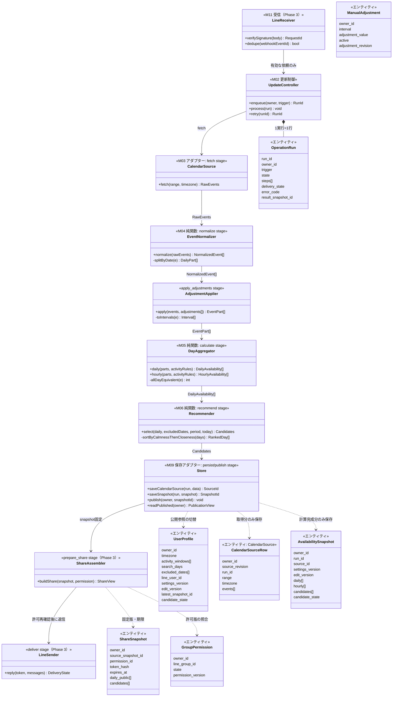
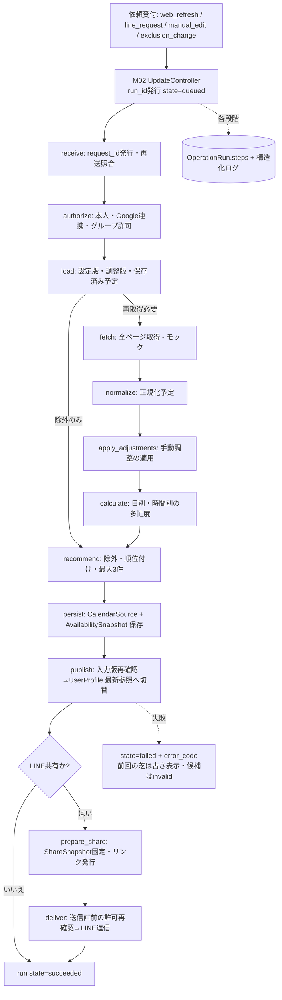
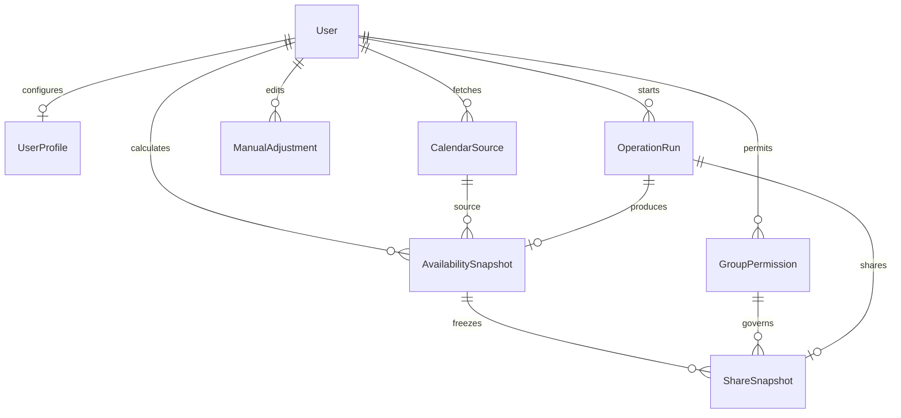

# りすけ（Risuke）アーキテクチャ

更新日：2026-10-17（line-testブランチの新設計へ更新）
設計の入口：`docs/schedule-design-index.md`（line-testブランチ）
正本の参照先：
- DB草案：`docs/schedule-state-and-schema.md`（Base44最小構成・標準User＋7エンティティ）
- 実行・ログ：`docs/schedule-operation-log-spec.md`（run_id / stage / error_code / delivery_state）
- LINE仕様：`docs/schedule-line-spec.md`

## 方針

- **DBはBase44内蔵DB**（旧PostgreSQL草案はアーカイブ済み・採用しない）。
- 初版の範囲：**本人の芝・候補・LINE固定リンク共有**のみ。AI補正・4人比較・画像生成・エクスポート・詳細開発者画面は後回し。
- **フロントのデザインは未確定**。UIはデザイン確定後に実装する。本書ではUIを構成要素としてのみ示す。
- 計算コア（正規化・多忙度・候補選出）は **DB・外部APIを一切知らない純関数**。固定入力で単独実行できる。
- Google・LINE・DB・時計はアダプターで交換可能。Phase 1 の Google 取得はモック（fixture_check）。
- 手動調整は「候補日からの除外」と「時間帯編集」の2種（日別多忙度は直接編集しない）。

## 1. クラス図（モジュール・データ契約・エンティティ）



計算コア（EventNormalizer・AdjustmentApplier・DayAggregator・Recommender）はエンティティを直接扱わない。Store が純関数の入出力とエンティティの橋渡しをする。

## 2. データフロー（stage順：実行ログ仕様と同一の段階名）



段階は `schedule-operation-log-spec.md` §4 の stage 名（receive〜deliver）に1:1で対応する。state は queued → running → succeeded / failed / superseded / ignored。

## 3. ER図（論理関連・line-test草案§4と同一）



所有者・版の一致はサーバー側で検証する（DB側のFK/UNIQUE保証は前提としない）。

## 4. Phase 1 のスコープ（フロント除く）

| 対象 | 内容 |
|---|---|
| エンティティ定義 | 標準User + 7エンティティのスキーマ（RLSは後で設定） |
| 計算コア | normalize / busyness / recommend の純関数 |
| 仮データ | Git管理の固定JSON（正常・重複・日跨ぎ・終日・0件・全日多忙・Google互換） |
| モック取得 | CalendarSource アダプターのモック実装 |
| 更新制御 | trigger=fixture_check / web_refresh の run 発行と stage 記録 |
| 除外 | UI実装・LINE送信・共有・Google実API接続 |

受入条件（草案§10・ログ仕様§9より）：
- 架空データから取得相当→正規化→計算→保存を同じ run_id で追える。
- 今日と除外日が候補に出ず、同点は近い日順。正常0件は reason_code=NO_CANDIDATES で表す。
- 未取得と空きを区別する。計算成功と送信失敗を分離する。
- 固定入力で各モジュールを単独実行できる。

## 5. ディレクトリ構成

```
src/
├── routes/                     # 画面（デザイン確定後に実装）
├── components/
├── lib/
│   ├── modules/                # ★計算コア（純関数・DB非依存）
│   │   ├── normalize.js        # normalize stage
│   │   ├── busyness.js        # calculate stage
│   │   └── recommend.js        # recommend stage
│   ├── adapters/               # ★外部接続の交換口
│   │   ├── calendar-mock.js   # fetch stage（モック）
│   │   └── store.server.js    # persist / publish stage
│   ├── update.server.js        # M02 更新制御（run・stage管理）
│   └── server-fns.js          # 画面用API（Phase 1では検証用のみ）
├── mock/seed.json              # 仮データ原本（Git管理）
base44/entities/                # 標準User + 7エンティティ
```

## 6. モジュール契約（固定・変更時は承認を要する）

計算コアの入出力契約。シグネチャ・不変条件の変更は承認後にのみ行う。

### 6.1 モジュール入出力

| モジュール（ファイル） | 入力 | 出力 | 不変条件 |
|---|---|---|---|
| fetchFixture (calendar-mock.js) | fixture名 | { sourceRevision, timezone, offsetMinutes, range, events[] } | eventsの要素は正規化前イベント形式に従う |
| normalize (normalize.js) | rawEvents（正規化前イベント形式の配列） | { events, stats: {received, valid, excluded} } | cancelled除外・provider_event_id重複除外・時刻整合検証 |
| calculateDaily (busyness.js) | { events, dates, offsetMinutes, activityWindow } | DailyAvailability[] | datesに含まれない日は出力しない（未取得と空きの区別） |
| calculateHourly (busyness.js) | 同上 | HourlyAvailability[] | 60分区切り・活動時間の端は短縮 |
| select (recommend.js) | { daily, today, excludedDates, maxCandidates } | { candidateState, candidates[] } | 最大3件・今日/除外日を外す・同点は近い日順 |

### 6.2 正規化イベント形式とGoogle Calendarの対応

| 内部項目 | Google Calendar Events | 変換規則 |
|---|---|---|
| kind | start/end の形状 | dateTimeがあれば timed、dateのみなら all_day |
| provider_event_id | id | そのまま |
| starts_at / ends_at | start.dateTime / end.dateTime | RFC3339（オフセット含む）をそのまま |
| start_date / end_date_exclusive | start.date / end.date | 終了日は排他的のまま保持 |
| status | status | 省略時はconfirmed（Google既定値）。confirmed/tentativeを保持、cancelledは除外 |
| transparency | transparency | 省略時はopaque |
| event_type | eventType | 省略時はdefault |
| participation_status | attendees[].responseStatus | 本人のresponseStatus。attendeesなし（本人単独の予定）はacceptedとする案（未確認事項・要合議） |

### 6.3 集計規則（多忙とみなす条件）

status が confirmed または tentative × transparency ≠ transparent × participation_status = accepted × event_type ≠ workingLocation。

### 6.4 契約検証

src/mock/seed.json の固定フィクスチャが契約検証用の正本。モジュール変更時は全フィクスチャで期待値が崩れないことを確認する。

## 7. 未決・後回し

- フロントデザイン：確定後に実装。
- LINE実送信・共有リンク・本人連携方式・秘密の保管先：Phase 3。
- Google実API接続：テスト利用者1人での接続検証は別途。
- 編集値の粒度・再取得時の調整維持・終日合成・排他制御の接続検証（D07相当）。
- participation_status の本人特定方法（attendees内のself・organizer優先）と、tentative回答の多忙扱い。