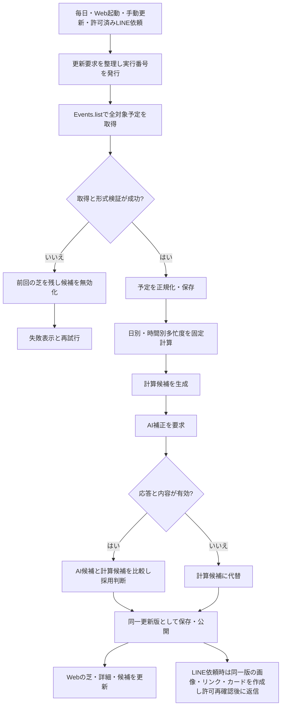

# 予定候補提案：設計資料の入口

更新日：2026-10-17

## 資料の分担
| 資料 | 管理する内容 |
|---|---|
| [外部設計・ユースケース](schedule-external-design.md) | 利用者／共有閲覧者／開発者の操作、画面、公開範囲、ユースケース図 |
| [内部設計・情報フロー](schedule-internal-flow.md) | モジュール、入力・出力、保存データの分担、全体フローチャート |
| [状態遷移・DBスキーマ](schedule-state-and-schema.md) | 更新処理・候補・共有許可・リンクの状態遷移、テーブル、ER図 |
| [意思決定記録](adr/2026-10-15-schedule-recommendation.md) | 選択理由、決定経緯、保留事項 |
| [用語集](adr/glossary.md) | このプロジェクトで使う用語の定義 |
| [LINE連携仕様](schedule-line-spec.md) | グループBot、候補カード、本人連携、共有許可・失効 |

過去資料は[アーカイブ一覧](archive/README.md)に保存する。現行の外部設計・内部設計を参照し、アーカイブの旧方針を実装要件として扱わない。

## 現在の設計基準
- Webアプリをリンク・QRから開く。最大4人を1日1マスの内部で比較する。3人は3分割。
- 日付タップで1時間別の詳細を表示する。
- 必要な予定情報をEvents.listで取得し、バックエンドで保存・処理する。
- 多忙度は固定ロジック。日別と時間別を生成し、候補選出は別モジュールで行う。
- 候補は日付のみ。計算とAIの比較・パラメータ調整を開発者モードで行える設計。
- ネイティブアプリ・辞書・ダウンロード案内を削除。LINEグループでメンション＋固定文から本人の予定を再取得し、最大3枚の候補カード・画像・リンクを返す。1〜2件はある分だけ、0件はメッセージ。LINE連携仕様を参照。
- DB製品、重みの具体式、AIモデル等は未決。設計草案を実装済みと扱わない。

## フローチャート：通常更新と例外

計算・DB保存の失敗は新版を公開しない。詳細な例外と競合制御は内部設計・状態遷移資料を参照。

## 更新ルール
1. 新しい要望を決定／提案／未決に区別する。
2. UI・利用者操作の変更は外部設計へ反映する。
3. 入出力・計算・接続の変更は内部設計とフローチャートへ反映する。
4. 状態・保存内容の変更は状態遷移図・DBスキーマへ反映する。
5. 関係する古い記述を修正し、重要な判断は意思決定記録へ追記する。

## 今後確定する項目
- PostgreSQL採用、活動時間の区間数。
- 終日換算の合成・上限、全日多忙時の扱い。
- LINE本人連携の具体方式・呼出キーワード、Web比較相手の追加。LINE共有は日別・時間別多忙度。
- AIモデル・補正式・待機時間、実API接続のモック範囲。
- 保存期間、エクスポート形式、LINE返信の待機時間。リンクは最終候補日後・最大1カ月で失効し、グループ共有解除でも失効。
