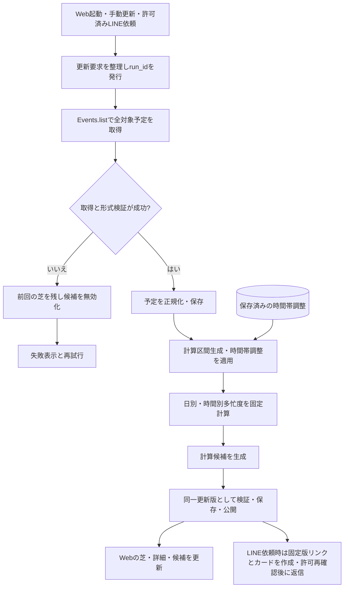

# 予定候補提案：設計資料の入口

更新日：2026-10-17

## 資料の分担
| 資料 | 管理する内容 |
|---|---|
| [外部設計・ユースケース](schedule-external-design.md) | 利用者／共有閲覧者／開発者の操作、画面、公開範囲、ユースケース図 |
| [内部設計・情報フロー](schedule-internal-flow.md) | モジュール、入力・出力、保存データの分担、全体フローチャート |
| [状態遷移・DB草案](schedule-state-and-schema.md) | Base44標準User＋7種類、時間帯調整、候補・共有・送信状態、ER図 |
| [実行・ログ仕様](schedule-operation-log-spec.md) | run_id、stage、error_code、正常理由、送信結果、ログの合格条件 |
| [ローカル検証版の保存記録](schedule-local-prototype-storage.md) | SD2602の最小検証実装（保存なし）の記録。Base44設計とは区別 |
| [意思決定記録](adr/2026-10-15-schedule-recommendation.md) | 選択理由、決定経緯、保留事項 |
| [用語集](adr/glossary.md) | このプロジェクトで使う用語の定義 |
| [LINE連携仕様](schedule-line-spec.md) | グループBot、候補カード、本人連携、共有許可・失効 |

過去資料は[アーカイブ一覧](archive/README.md)に保存する。現行の外部設計・内部設計を参照し、アーカイブの旧方針を実装要件として扱わない。

## 現在の設計基準
- Webアプリをリンク・QRから開く。初版は本人の芝・候補・LINE共有に絞り、4人比較は後回し。
- 日付タップで1時間別の詳細を表示する。
- 必要な予定情報をEvents.listで取得し、バックエンドで保存・処理する。
- 多忙度は固定ロジック。日別と時間別を生成し、候補選出は別モジュールで行う。
- 候補は日付のみ。固定計算を使用し、AI補正・詳細な開発者画面・エクスポートは後回し。
- ネイティブアプリ・辞書・ダウンロード案内を削除。LINEグループでメンション＋固定文から本人の予定を再取得し、最大3枚の候補カードと固定版リンクを返す。画像は後回し。1〜2件はある分だけ、0件はメッセージ。
- 本人が日付を候補から除外・解除できる。編集は時間帯のみで、日別多忙度は直接編集しない。編集値・単位・重複優先・再取得後の扱いは未決。
- Base44を利用する前提。標準User＋7種類のDB草案に整理し、ローカルで同じ形式の保存・再読込を先に確認する。スキーマ適用・動作確認済みとは扱わない。

## フローチャート：通常更新と例外

計算・DB保存の失敗は新版を公開しない。詳細な例外と競合制御は内部設計・状態遷移資料を参照。

## 更新ルール
1. 新しい要望を決定／提案／未決に区別する。
2. UI・利用者操作の変更は外部設計へ反映する。
3. 入出力・計算・接続の変更は内部設計とフローチャートへ反映する。
4. 状態・保存内容の変更は状態遷移図・DBスキーマへ反映する。
5. 関係する古い記述を修正し、重要な判断は意思決定記録へ追記する。

## 今後確定する項目
- Base44での排他・最新版切替・再送抑止の検証、活動時間の区間数。
- 終日換算の合成・上限、全日多忙時の扱い。
- 時間帯編集の値・単位・重複優先・再取得後の維持・解除規則。
- LINE本人連携方式・呼出キーワード・待機時間。実接続はテスト本人1人のGoogle再取得と実LINE返信。
- 保存期間とリンク期限の厳密な境界。最終候補日後・最大1カ月で失効し、グループ共有解除でも失効。
