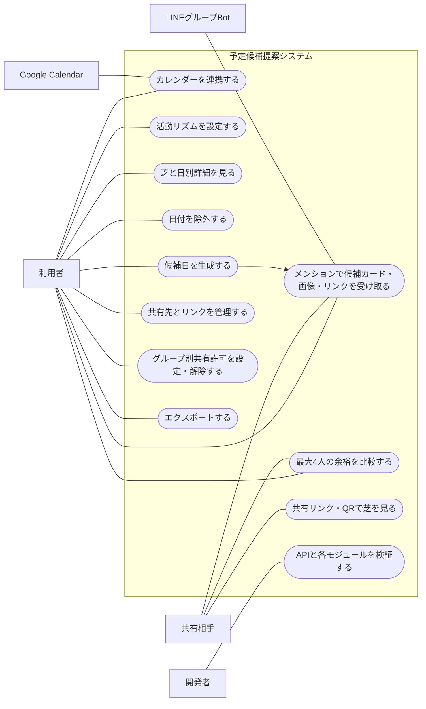
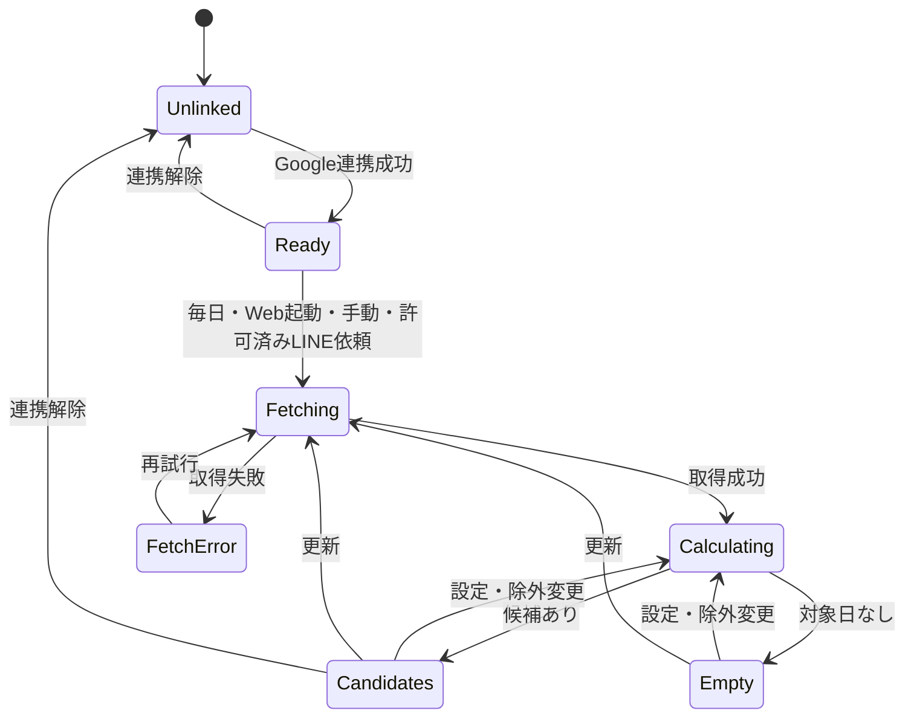

# 予定候補提案：外部設計・検証計画

更新日：2026-10-17。実装前の草案。決定と未決を区別する。
初版の範囲：本人の芝・候補・LINE共有。以下の4人比較・AI補正・詳細開発者画面・エクスポート・画像共有は将来案として後回し。手動調整は日付の候補除外と時間帯編集のみ。最新の保存・状態は[Base44用DB草案](schedule-state-and-schema.md)、段階・原因は[実行ログ](schedule-operation-log-spec.md)を参照。

## 手動調整の追加
- 本人画面で日付を候補から除外・解除できる。除外だけでは多忙度を変更しない。
- 時間帯の長押し・右クリックから調整する。日別の数値を直接編集しない。
- 時間帯調整はGoogle由来の予定と別に保存し、適用後に時間別・日別多忙度と候補を再計算する。
- 編集値・区間の粒度・重複時の優先順位・再取得後の維持・元に戻す方式は未決。
- 編集は本人画面のみ。共有版は固定で、後の編集は次の共有に反映する。

## 基本仕様
- UIはリンクから開けるWebアプリを基本とし、芝の閲覧・比較のためのアプリインストールは不要とする。
- ネイティブアプリ・辞書連携・ダウンロード案内を削除し、[LINEグループBot仕様](schedule-line-spec.md)に置き換える。
- 比較時は画面を人数別に分割せず、1日1マスの内部を参加者別に分割する。本人を含め最大4人まで比較可能。スマホでの見やすさを優先する。
- 参加人数に合わせて1マスを分割し、3人の場合は余り領域を作らず3分割する（決定）。配置案は2人が左右2分割、3人が縦3列の等分割、4人が2×2。各人の位置を日付間で固定し、名前・位置の凡例と、タップ後の数値一覧を設ける案。
- Webの3〜4人比較に必要な参加者選択方法・比較対象の固定方法は未決。公開リンクを見ただけの人を自動参加させない案。LINEでは依頼者本人のみから候補を作り、複数人の候補順位付けは対象外。
- 共有リンクはリンクを知っている全員が閲覧可能。閲覧者の招待・承認は不要だが、LINEへ送る所有者の共有許可はグループ別に必要。QRでも同じURLを開ける。
- 閲覧者自身のデータが登録済みで本人を識別できる場合、共有元と閲覧者の日別多忙度を1マスの分割表示で比較する。本人識別方法は未決。未登録・未識別の場合は共有元のみ表示する案。
- LINE共有は日別・時間別多忙度を公開。リンクは依頼版に固定し最終候補日後・最大1カ月で失効。許可解除でも関連リンク失効。共有URLからGoogle認証情報や他者の非公開データにアクセスさせない。
- 候補カードは日付のみ。時間帯推薦は対象外。参考画像と共有リンクを併せて返信し、リンク先で依頼時点の日別・時間別多忙度を確認できる。
- 多忙度はAIではなく固定ロジックで日別・1時間別に算出する。1時間別は枠内の予定占有率。候補選出は日別多忙度を基本にする。
- 多忙度決定と候補日決定を分離し、開発者モードで重み等を調整・比較できるようにする。将来用の未指定パラメータは現行計算に影響させない。
- 基本処理と必要項目に絞った予定データ保存はバックエンドで行う。起動時に裏で取得・芝・詳細・候補をまとめて更新する。
- Google取得失敗時は前回の芝・詳細を失敗表示付きで残し、候補は無効化する。LINEには取得失敗を案内し、古い候補で代用しない。閉じる前の更新完了は保証せず再試行する設計案。
- AIはHugging Face APIをバックエンドから利用する意向。計算候補とAI候補を比較し、AI失敗時は計算候補を使う。候補選出のみAIを1回呼ぶ案で、モデル・待機時間・実装は未決。
- 月間一覧は1日1マスとし、クリックした日の詳細を1時間ごとに表示する。候補日選出は日単位のまま維持する。
- 添付画像を表示構成の参考にする。PCでは月間芝と選択日の詳細を並べる構成を提案。画像内の右クリック編集や時間帯別の多忙度ラベルは未採用。
- Google取得はEvents.listを採用する。
- 個別ルールは、終日予定を6時間換算、重複時間を二重計上しない、日跨ぎ予定を日別分割する。複数終日予定と通常予定の合成・上限は未決。
- 今日を候補に含めない。
- 活動時間は基本の生活リズムを把握し、本人が調整可能にする。曜日別の具体的UIは未決。
- 候補は最大3件、1〜2件ならある分だけ。0件は「候補日が見つかりませんでした」。全日多忙時の扱いは未決。除外日・未取得日は勝手に復活させない。

## LINEで追加・変更する操作
Webの芝・日別詳細・設定・比較と、バックエンドでの予定取得・計算・保存は維持する。変更はネイティブアプリの導線をLINEでの依頼・共有に置き換える部分を中心とする。

| 操作 | 利用者から見た動作 |
|---|---|
| 初回利用 | 個別の連携導線から本人を紐付け、サイトでGoogle連携する。表示名だけで本人を識別しない |
| グループへの公開許可 | 対象グループと公開内容を個別画面で確認して許可する。本人連携だけでは共有を許可しない |
| 候補依頼 | グループでBotをメンション＋固定文。Web設定の期間で本人の予定を再取得する |
| 結果閲覧 | 最大3枚の候補日カード、芝画像、共有リンク。1〜2件はある分だけ。0件はメッセージ |
| 日付投稿 | 日付ボタンを押した人の発言として投稿。投票・参加表明・日程確定にはしない |
| 詳細閲覧 | 画像・カードと同じ依頼版の日別・時間別多忙度をWebで確認。後の更新で差し替えない |
| 許可解除 | Webで利用者×グループの許可を解除し、その組合せの既存リンクも失効。再許可で旧リンクは復活しない |

リンクは最終候補日後・発行から最大1カ月で失効する。期限切れは再依頼を案内する。送信済みの画像・カード・日付テキストは残り、リンクは転送先でも閲覧され得ることを許可画面で説明する。詳細は[LINE仕様](schedule-line-spec.md)。

## システム境界（提案）
最新の情報フローとモジュール分担は[内部設計：情報の流れ](schedule-internal-flow.md)に整理。ネイティブアプリ・辞書反映は対象外。LINE Botが依頼受付と返信を担当する。
ブラウザ／PCは閲覧・設定・共有・開発者操作。サーバーはGoogle取得・集計・候補生成・保存。LINEはグループでの依頼・候補日投稿・Webへの導線。本人連携とグループ共有許可は独立管理。
Google、LINE、時計、保存先を差し替え可能な接続口に分離する。計算部分はそれらの実装を知らない。

## 画面仕様
| ID | 画面 | 入力・操作 | 出力・異常時 |
|---|---|---|---|
| S01 | 初期設定・連携 | 本人連携、Google連携、活動時間、タイムゾーン | 許可結果、未連携・再認証案内 |
| S02 | ホーム | 年月移動、期間、日付タップ、更新、比較相手 | 芝、凡例、候補、取得日時・生成日時。未取得を空き扱いしない |
| S03 | 日別詳細 | 芝の日付選択、除外・解除、カレンダーで開く | 日付、予定時間、活動時間、多忙度、換算根拠、1時間ごとの予定・空き表示 |
| S04 | 共有 | 相手追加、比較、リンクコピー・QR表示 | リンクを知る全員が閲覧可。承認不要。LINEはグループ単位で許可・解除。日別・時間別を公開し、解除で該当リンク失効 |
| S05 | 設定 | 活動リズム、期間、Google解除、エクスポート、グループ共有許可・解除 | 保存結果。解除しても送信済みの画像・カード・テキストは残る。出力形式・データ削除仕様は未決 |
| D01 | 開発者 | モック／実データ選択、個別／一括実行、固定入力、失敗注入 | API状態、各モジュールの入力・出力、実行番号、処理時間、エラー。認証秘密は表示しない |

通常のホームから設定・詳細・共有へ移動できる。PCのモード切替でD01へ移動するが、アクセス権はサーバー側でも検証する。

## モジュール間の契約（草案）
- 日別集計だけでなく、選択日の時間帯別表示用の予定区間も提供する。1時間未満の予定は実際の開始・終了に応じた部分表示を提案。1時間の枠全体を予定ありと丸めない。
- 終日6時間換算は日別指標のみに使用し、時間別表示では終日欄に表示する案。架空の6時間をタイムラインに配置しない。
- 活動時間外は空き時間と区別して対象外表示する案。LINE共有は時間別多忙度も公開し、予定名・本文は公開しない。
- CalendarSource.fetch(range, timezone) → 予定一覧または取得エラー。特殊予定の区別に必要な情報を正規化する。
- DayAggregator.calculate(events, activityRules) → 日付、活動分数、換算済み予定分数、指標、根拠。
- Recommender.select(days, exclusions, period) → revision、日付配列、選出理由。今日以前・除外日・未取得日を対象外とする。
- LINE共有スナップショットはowner、group、revision、timezone、generatedAt、expiresAt、日別・時間別多忙度、候補日を固定する。具体型は実装時に設計。

## Google取得方針の見直し
FreeBusyだけでは終日予定と通常の長時間予定、重複元のイベントを区別できないため、Events.listでイベント単位の情報を取得することを決定した。
必要項目は開始・終了、終日区分、状態、空き扱い区分など。予定名・本文は要求しない設計を目指す。権限は取得要件を満たす読み取り範囲で再確認する。
繰り返し予定の展開、ページ取得、タイムゾーンを扱う。
公式資料：https://developers.google.com/workspace/calendar/api/v3/reference/events/list

## LINE連携の検証
[LINE連携仕様のデモ合格条件](schedule-line-spec.md)に従う。本人照合、グループ別許可、依頼時再取得、版一致、0〜3件、失効・解除・再送を確認する。

## ユースケース図
Mermaidではユースケース風のフローチャートとして表現する。Web共有・最大4人比較を含む。LINEでの候補提案を含む。

主要ユースケース：利用者が連携・活動時間設定→芝を確認→必要なら日付除外→候補生成。共有リンク・QRからログイン不要で共有元の芝を閲覧し、本人データを識別できれば最大4人を比較する。LINEで依頼者の予定を再取得して最大3件を返信する。日付ボタンはトークへの提案投稿のみで投票・確定・保存しない。
代替：取得失敗なら未取得として案内。候補不足はある分だけ。0件は見つからない旨を返信。未連携・未許可は個別設定へ案内。

## 状態遷移図：データ取得と候補
以下は概略図。最新の詳細状態・候補有効性・共有リンク状態は[状態遷移とDB設計](schedule-state-and-schema.md)を参照。

## LINE依頼と共有の状態
[状態・DB設計](schedule-state-and-schema.md)と[LINE仕様](schedule-line-spec.md)を参照。本人連携・Google連携・グループ共有許可は別状態とする。

## モック合格条件（提案）
- 今日と除外日が候補に出ず、同点は近い日順。
- 計算根拠が日別詳細と開発者モードで一致する。
- 未取得と空き日を区別する。
- 固定入力で各モジュールを単独実行できる。
- LINEの未連携・未許可・正常0件・取得失敗を区別し、同一版共有・許可解除・期限切れを確認する。

## 残る判断
1. 終日6時間換算と通常予定の合成方法・複数終日予定の扱い・活動時間が6時間未満の日の上限。
2. 全日多忙でも最も余裕のある1日を出すか。候補件数自体は最大3件・ある分だけで確定。
3. 活動時間の曜日別UI、出力形式、保持期間、LINE本人連携方式・キーワード・待機時間。共有許可・期限はLINE仕様を参照。
