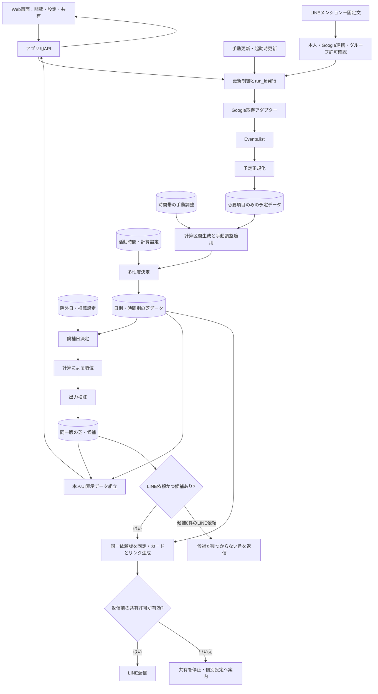

# 情報の流れとモジュール構成

更新日：2026-10-17。会話の決定を基にした内部設計草案。具体的なデータ契約・保存構造は提案。

## 範囲
UIはWeb。基本処理・保存はバックエンド。ネイティブアプリ・辞書連携を削除し、LINEグループBotへ置き換える。確定仕様は[LINE連携仕様](schedule-line-spec.md)を参照。
今回の範囲は本人の芝・候補・LINE共有。多忙度・候補は固定ロジック。4人比較、AI補正、詳細な開発者画面、エクスポート、画像は後回し。Base44の保存・版・ログは[DB草案](schedule-state-and-schema.md)と[実行・ログ仕様](schedule-operation-log-spec.md)に従う。

## 情報の流れ

矢印は情報の依存関係。AIやGoogleの認証秘密はブラウザへ返さない。共有リンクは公開用の表示データだけを返す。

## モジュール一覧
| ID | モジュール | 入力 | 出力・責務 |
|---|---|---|---|
| M01 | 設定・ユーザー識別 | 活動リズム、探索期間、除外日、本人識別 | 設定と版番号。LINEはuserIdで識別、表示名は表示用。紐付け方式は実装時に決定 |
| M02 | 更新制御 | 毎日・起動・手動更新、設定変更、LINE依頼時の再取得 | 実行番号、取得／再計算の指示、再試行、古い結果の排除 |
| M03 | Google取得 | 対象カレンダー、期間、認証情報 | 全ページ・繰り返しを考慮した必要項目、取得状態 |
| M04 | 予定正規化 | Google由来の予定 | 保存用共通形式と終日区分。日跨ぎ分割・重複統合は計算区間生成で行う |
| M05 | 多忙度決定 | 正規化予定、活動時間、計算設定 | 区間生成・調整適用、日別・1時間別の多忙度、根拠。外部AIは呼ばない |
| M06 | 候補日決定 | 日別芝、期間、除外日、推薦設定 | 固定計算による最大3件。除外日適用、同点は近い日順 |
| M07 | AI接続（後回し） | 日別多忙度など必要最小の特徴・設定 | 構造化した順位補正結果、失敗・タイムアウト。予定名や認証情報は送らない |
| M08 | 表示・共有組立 | 芝、候補、共有リンク、最大4人の対象 | 本人・共有表示の公開DTO、LINE固定版リンク。画像・比較は後回し |
| M09 | 保存 | 型検証済みデータと版番号 | DB保存・読取。途中保存を公開しない仕組み |
| M10 | 詳細開発者画面（後回し） | 固定入力、設定変更、実行指示、評価 | 各段階の入力・出力、計算とAIの比較、障害再現、評価記録 |
| M11 | LINE受信・返信 | メンション＋固定文、userId・groupId | 本人・連携・グループ許可確認、更新依頼、候補カード・リンク、再送重複防止。日付選択の回答保存なし |

これらは論理モジュールであり、別サーバーにする必要はない。まず1つのバックエンド内で責務と接続口を分ける案。
Google、AI、DB、時計、LINEはアダプターで交換可能にし、計算部分を単独で動かす。

## LINE追加による内部処理の差分
- M01〜M10の基本責務を維持し、辞書配信に代えてM11をLINE接続口にする。別の計算エンジンやグループ全員分の推薦処理は追加しない。
- M11はメンション＋固定文を受け、M01の本人連携と利用者×グループの共有許可を確認してM02へ再取得を依頼する。未連携・未許可は個別設定へ案内する。
- M02〜M06で本人の予定取得・調整適用・多忙度計算・候補生成を行う。正常0件と取得・計算・保存失敗を区別する。
- 候補がある場合はM08・M09で同一runの芝・候補・公開情報を固定し、M11で許可を再確認して返信する。1〜2件ならある分だけ、日付投稿の回答保存はしない。
- Web本人画面の最新参照と、LINEリンクの固定参照を区別する。LINE公開APIはリンクの期限・失効と現在の共有許可を検証し、後続更新の情報に差し替えない。
- 共有解除は既存リンクと送信待ち処理へ反映する。再許可で旧リンクを復活させない。送信済み画像などを消去できたとは扱わない。
- Webhook・送信の処理状態は計算runと別に追跡する。認証方式、重複防止・再試行・競合制御の具体実装はプログラミング設計で決める。

## 芝と推薦の境界
- 日別：活動時間内の予定時間を基礎に多忙度を計算。終日6時間換算。合成方法・上限は未決。
- 時間別：各1時間枠に実際の予定が占める割合。部分予定の実区間も保持する。終日換算を架空の6時間として割り当てない案。
- 推薦：明日以降、対象期間内、除外されていない取得済みの日が対象。基本は日別多忙度順、同点は近い日順。
- 最大3日。1〜2件ならある分だけ表示。0件は「候補日が見つかりませんでした」。水増ししない。
- AI補正は後回し。今回の候補選出は固定ロジックだけで検証する。
- 空の拡張パラメータは未指定として無視する。0や推定値に置換しない。
- 最終候補は今日・除外日・重複・対象外日を検証する。0件は正常で、計算失敗とは区別する。

## 保存データの分離（Base44草案）
[状態・DB草案](schedule-state-and-schema.md)を正本とし、標準User＋7種類に整理する。

| データ | 役割 |
|---|---|
| UserProfile | 本人設定、除外日、LINE対応、連携状態、最新結果参照 |
| CalendarSource | 全取得成功分の必要項目だけの正規化予定 |
| ManualAdjustment | 現在有効な時間帯調整。Google予定とは別入力 |
| AvailabilitySnapshot | 同じ版から作る日別・時間別多忙度と候補 |
| GroupPermission | 利用者×グループの共有許可と許可版 |
| ShareSnapshot | 依頼時点の固定公開情報、リンク、期限・失効 |
| OperationRun | 実行ID、段階、使用版、成否、送信状態、最小限の追跡情報 |

予定名・本文は保存しない方針。日付はISO日付、時刻はタイムゾーンが分かる形、割合は数値、未取得は状態で表す。
保存前・外部API受信時・公開API返却時に形式を検証する。schemaVersionを付ける案。保持期間・削除仕様は未決。

## 更新の種類
| 契機 | 再実行 |
|---|---|
| Web起動・手動更新・許可済みLINE依頼 | 予定取得→正規化→芝生成→候補選出 |
| 活動時間・計算パラメータ変更 | 保存済み予定→芝生成→候補選出 |
| 除外日・探索期間・推薦パラメータ変更 | 保存済み芝→候補選出。探索期間が取得範囲を超えたら追加取得 |
| 時間帯の編集・解除 | 調整保存→多忙度→候補。日別を直接編集しない。適用規則は未決 |

同時要求はユーザー単位でまとめるか順序制御し、遅く返った古い実行結果を最新として公開しない。新しい芝・詳細・候補は同じ更新版として公開する。更新中は直前の表示を残す。

## 失敗時の流れ
| 失敗 | 表示・候補の扱い |
|---|---|
| Google取得 | 前回の芝・詳細に失敗・古さを表示。候補を無効化し再取得。LINEには古い候補で代用せず失敗を案内 |
| 時間帯調整後の再計算 | 調整保存と計算の成否を分ける。計算失敗なら候補を再計算必要と表示 |
| 芝計算・DB保存 | 新版を公開せず前回表示を残す。候補無効化と失敗状態の永続化方法は実装時に設計 |
| 共有対象の取得 | 未取得として表示し、空き扱いしない |
| LINE返信 | 計算成功と送信成功を別管理。待機時間・再送方式は実装時に設計 |

フロント終了前の取得完了は保証しない。開始済みバックエンド処理と再試行をWeb接続から独立させる案。
DB停止で有効性を検証できない公開APIはデータを返さない。LINE共有は依頼版に固定し、後続更新で差し替えない。期限・グループ許可を確認する。

## ログで追う情報（詳細画面は後回し）
run_id→取得・設定・調整版→正規化→調整適用→多忙度→候補→保存→共有→送信。stageとerror_codeは[ログ仕様](schedule-operation-log-spec.md)の固定値を使う。
同じ固定入力の期待値・計算根拠と段階別ログを確認する。ログだけを設定・候補の正本として使わない。
モックAPIで取得失敗、不正形式、調整保存後の計算失敗、保存失敗、古い応答、LINE送信結果不明を再現する。

## 残る主な判断
- 時間帯編集の値・粒度・重複優先・再取得時維持・解除、固定計算の具体式。
- 終日換算の合成規則、全日多忙時の扱い。
- LINE本人連携方式、Base44での排他・最新版切替・再送防止。
- 保持期間、エクスポート形式、LINEの待機時間・タイムアウト。失効条件はLINE仕様を参照。
- Google再取得と実LINE返信はテスト本人1人で通す。AI・4人比較は後回し。

関連：[外部設計](schedule-external-design.md)、[意思決定記録](adr/2026-10-15-schedule-recommendation.md)。
