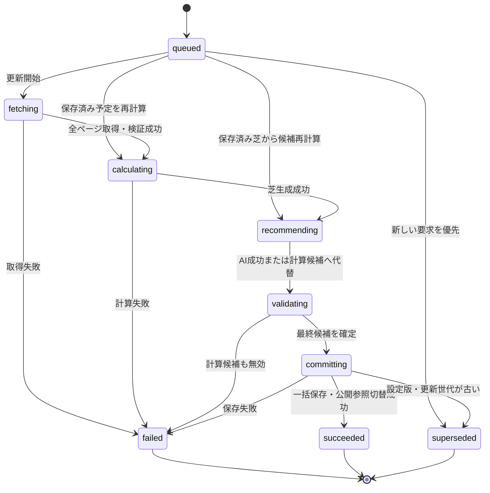
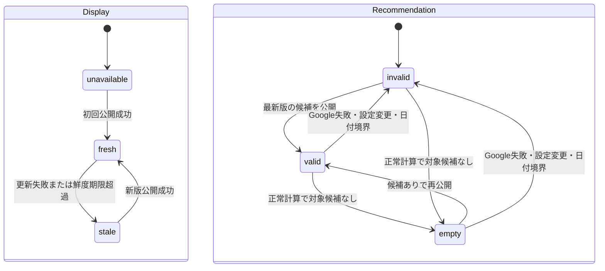
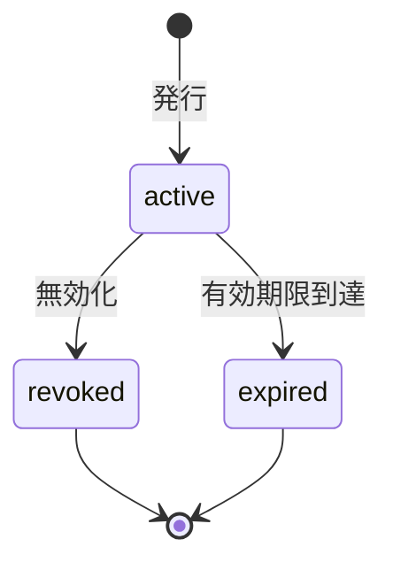
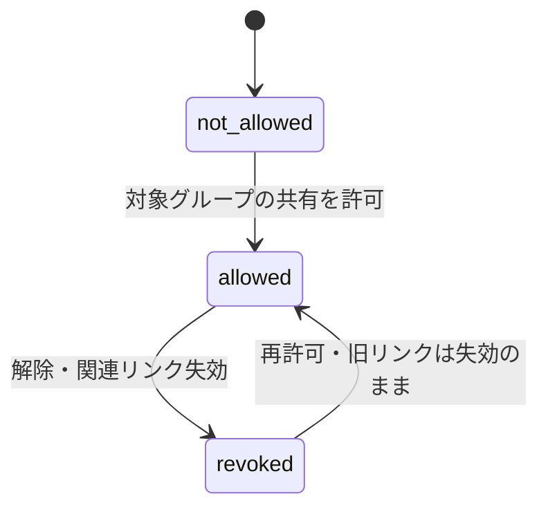
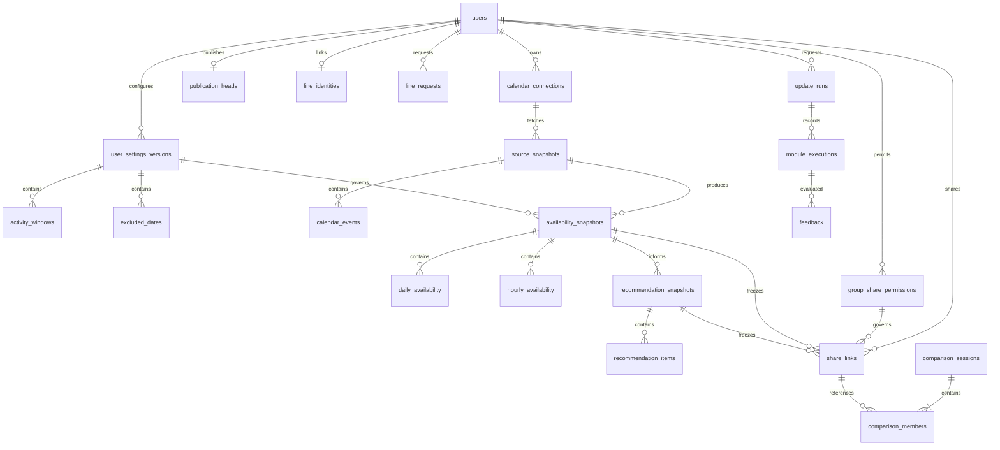

# 状態遷移とDB論理スキーマ

2026-10-17更新。内部設計草案。PostgreSQLを前提とする提案であり、DB製品・DDLは未確定。既存仕様に基づくが、この文書の新規設計はユーザー承認前。

## 設計方針
- 更新処理、表示可能なデータ、候補の有効性、共有リンク、LINE本人連携、グループ別共有許可を別状態として管理する。
- 計算結果は更新単位のスナップショット。未完成版は公開せず、完了時に参照先をトランザクションで切り替える。
- 外部API呼び出し中にDBトランザクションを保持しない。
- 1バックエンド内のモジュール分離を前提とする。

## 1 更新処理

再試行は同じ行を巻き戻さず、新runを作りretry_ofで関連付ける。途中終了はheartbeat期限で検出する案。表示用の進行状況に使う。

## 2 表示データと候補

AI失敗だけではinvalidにせず計算候補を採用する。emptyは正常な候補0件、invalidは推薦に使えない状態。候補は最大3件、1〜2件はある分だけ。0件は正常なemptyとして扱う。
fresh/staleは最終成功日時と取得状態から導出し、DBの重複フラグにしない。鮮度期限は未決。
LINE送信失敗は計算失敗と別管理。共有済みの依頼版は後続更新で差し替えない。

## 3 共有リンク

LINE共有は依頼者本人の依頼版に固定し、日別・時間別多忙度だけを公開。利用者×グループの許可を確認して発行。リンクを知る人が閲覧できる。最終候補日後・最大1カ月でexpired、共有解除で関連リンクをrevokedとする。再許可でも復活せず、他グループに影響しない。QRはURLの表現。送信済み画像・カード・テキストは残る。詳細は[LINE仕様](schedule-line-spec.md)。

## 4 グループ別共有許可とLINE依頼
本人連携・Google連携と共有許可は独立した状態。LINE userIdで識別し、表示名は補助情報。
状態：未許可→許可済み→解除済み→再許可。解除で関連リンクを失効させ、再許可でも旧リンクを復活させない。

LINE依頼は受信→本人・連携・許可確認→Google再取得→計算→共有版固定→許可再確認→返信。
未連携・未許可は個別設定へ案内。0件は正常メッセージ、取得失敗は失敗メッセージ。日付投稿を投票・確定として保存しない。
送信済み・送信失敗を更新runの成功と区別する。待機時間・再送・本人連携方式は実装時に決める。

## 5 テーブル構成
共通：識別子はUUID、日時はtimestamptz、利用者の暦日はdate、分数はinteger。FKは明記した参照先を検証する。所有者をまたぐ関連は複合FK等で拒否する。

| テーブル | 主な列 | 制約・役割 |
|---|---|---|
| users | id PK, timezone, created_at | タイムゾーンはアプリ側でも検証 |
| auth_identities | id PK, user_id FK users, provider, subject | UNIQUE(provider, subject)。LINE userIdをsubjectとして識別する案。具体的連携方式は未決 |
| calendar_connections | id PK, user_id FK, provider, calendar_id, secret_ref, status, last_success_at | UNIQUE(user_id, provider, calendar_id)。認証秘密はsecret_refの参照先で保護 |
| user_settings_versions | id PK, user_id FK, version, effective_from, search_days, created_at | UNIQUE(user_id, version)。期間の具体選択値は未決 |
| activity_windows | settings_id FK, weekday, slot_no, start_minute, end_minute | PK(settings_id, weekday, slot_no)。0≦start＜end≦1440。深夜跨ぎは2区間に正規化する案 |
| excluded_dates | settings_id FK, date | PK(settings_id, date)。設定版ごとに固定 |
| parameter_versions | id PK, module, version, schema_version, values_json, created_at | UNIQUE(module, version)。JSONを版付きスキーマで検証。固定コア列とは分離 |
| source_snapshots | id PK, user_id FK, connection_id FK, range_start, range_end, fetched_at, schema_version | 全取得成功分だけ確定。不完全取得で前回を上書きしない |
| calendar_events | id PK, source_id FK, provider_event_id, starts_at, ends_at, start_date, end_date_exclusive, is_all_day, transparency, participation_status, provider_updated_at | UNIQUE(source_id, provider_event_id)。時刻型と終日の日付型は排他的。終了＞開始。予定名・本文なし |
| availability_snapshots | id PK, user_id FK, source_id FK, settings_id FK, calculation_params_id FK, run_id FK, generated_at | 元データ・設定・計算版を固定。日別と時間別の親 |
| daily_availability | availability_id FK, date, active_minutes, timed_busy_minutes, all_day_equivalent_minutes, effective_busy_minutes, busy_ratio | PK(availability_id, date)。割合0〜1または活動時間0ならNULL。合成式は未決 |
| hourly_availability | availability_id FK, date, slot_start, slot_end, active_minutes, busy_minutes, busy_ratio | PK(availability_id, slot_start)。区間は最大1時間、0≦busy≦active。対象外はNULL。元予定で部分表示を復元 |
| recommendation_snapshots | id PK, user_id FK, availability_id FK, recommendation_params_id FK, run_id FK, selected_method, fallback_reason, generated_at | AI成功／計算のみ／代替を区別。最終候補は子行 |
| recommendation_items | recommendation_id FK, variant, rank, date, reason_code | PK(recommendation_id, variant, rank)、UNIQUE(recommendation_id, variant, date)。variantはcalculated/ai/final |
| publication_heads | user_id PK FK, availability_id FK NULL, recommendation_id FK NULL, settings_id FK, generation, candidate_status, invalid_reason | 公開中の参照先。candidate_status=valid/empty/invalid。設定版・所有者・芝参照の一致を公開時に検証 |
| update_runs | id PK, user_id FK, trigger, generation, settings_id FK, state, retry_of FK NULL, started_at, heartbeat_at, finished_at, error_code | 世代と設定版が最新の場合だけ公開。terminal状態は更新しない |
| module_executions | id PK, run_id FK, module, attempt, state, input_ref_json, output_ref_json, duration_ms, error_code, model_id, provider | UNIQUE(run_id, module, attempt)。秘密や生の予定本文をログへ入れない |
| feedback | id PK, execution_id FK, author_id FK, rating, comment, created_at | 評価尺度は未決。比較した実行に結びつける |
| share_links | id PK, owner_id FK, group_permission_id FK, availability_id FK, recommendation_id FK, token_hash UNIQUE, status, expires_at, created_at | 同じ依頼の固定版を参照。所有者・許可・期限を閲覧時にも検証。列は提案 |
| line_identities | user_id FK, line_user_id UNIQUE, display_name | 本人連携。表示名は識別キーにしない。列は提案 |
| group_share_permissions | id PK, user_id FK, group_id, state, granted_at, revoked_at | UNIQUE(user_id, group_id)。解除で対象リンク失効。再許可で旧リンクは復活しない。列は提案 |
| line_requests | id PK, webhook_event_id UNIQUE, user_id FK, group_id, run_id FK, share_link_id FK NULL, reply_state | 二重返信防止・送信結果。投票・日付選択履歴なし。列は提案 |
| comparison_sessions | id PK, viewer_id FK, created_at | 比較は閲覧者自身の操作。グループ共有URLは今回未決 |
| comparison_members | session_id FK, position, share_link_id FK NULL, own_user_id FK NULL | PK(session_id, position)、position=0〜3。リンクか本人参照のいずれか。最大4人、重複所有者禁止をサーバーで検証 |

閲覧者の未ログイン比較を保存するかは未決。現段階ではログイン済み比較セッションのみ永続化し、未ログイン表示は共有元だけとする案。共有公開範囲はアプリの公開DTOで制限する。
ネイティブアプリ・辞書同期テーブルは削除。LINE関連データの採用DBへの実装は未確定。保存期間とリンク期限は別管理。

## 6 ER図（主要な関連）

## 7 一括公開の手順
1. runに世代・設定版を固定し、外部API取得と計算を行う。
2. source→availability→recommendationの各行を作る。未公開データは閲覧APIから参照させない。
3. 短いDBトランザクションでpublication_headsをロックし、世代・設定版・所有者を検証。
4. 芝・候補の参照先とcandidate_statusを同時に切り替え、runをsucceededにする。
5. 古い世代なら公開せずsupersededにする。
Google失敗時は前回availabilityを残し候補をinvalidにする。失敗処理も世代を照合し、古い失敗で新しい成功を無効化しない。
DB停止で無効化を書けない場合は配信エラーとして扱う。LINE共有APIは期限と共有許可を検証する。既存共有版は固定し、後続失敗で別版へ差し替えない。解除・期限でアクセス停止する。

## 8 インデックス・検証
- source_snapshots(connection_id, fetched_at)、daily_availability(availability_id,date)、share_links(token_hash)、update_runs(user_id,started_at)。
- 多くの参照はPK/UNIQUEを利用。FK列の必要な索引も作る。
- キャンセル／空き扱い等の具体的除外基準、終日合成は別ルールとして確定後にテスト。
- 型不正、外部API途中失敗、同時更新、古い失敗到着、活動時間0、候補0〜3件、日付境界、グループ別許可・解除・再許可、リンク期限、Webhook再送を検証する。
- 時間別に実区間を必要とする場合は対象sourceのcalendar_eventsを参照して部分描画データを作る。予定データを公開APIへそのまま返さない。

## 次に確定する項目
1. PostgreSQL採用の可否。
2. 曜日別活動時間：1日1区間か複数区間か。
3. 比較相手追加：共有リンク／QRの取り込みと本人識別方式。
4. 履歴保持期間、AIログの保存範囲、共有リンク再表示方式。

関連：[情報フロー](schedule-internal-flow.md)、[外部設計](schedule-external-design.md)。
