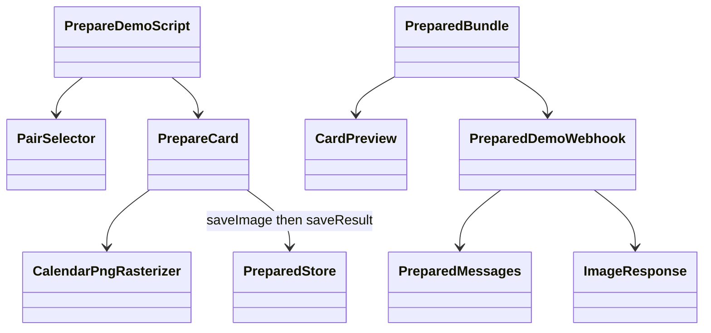

# 最新合意と実装状態（2026-10-18）

本書は会話で合意した現行仕様を統合した正本。過去の初版／将来区分や固定版共有の記述と競合する場合、本書を優先する。設計済みと実接続・検証済みを混同しない。

## 候補計算・表示
- 1人／2人とも最長連続空き時間→空き時間合計→近い日付で最大3日を選び、選出後は日付昇順。選出スコアは公開しない。
- 今日以前、明示除外、空きなし、終日予定日は除外。2人はどちらかに終日予定があれば除外。
- 多忙度は終日予定を1日6時間として通常予定と加算し、活動時間を上限とする。終日予定を架空の時間帯へ割り当てない。
- 現テストはAsia/Tokyo、09:00〜22:00、今日から31日。05:00〜24:00は表示枠であり活動時間を変更しない。対象時間外は未評価。
- カレンダーは最新の参考PC／スマホHTMLに合わせる。月バッジは今日と各月1日だけ、ヘッダーは簡潔にする。

## 共有
- 全日は双方の日別多忙度のみ。サーバー選出の候補日に限り双方の予定時間帯を確認できる。候補外の時間帯をブラウザへ送って隠す方式は使わない。
- 予定名・本文・場所・参加者・内部スコアは共有しない。候補日の時間帯を共有することを双方の同意対象に含める。
- 自動生成文とカード本文は候補日ごと各人1件（時刻が早い予定）まで、複数なら「など」。自由編集した連絡文は利用者が確認して送る。
- 選択した候補だけを連絡文・カード本文・画像の★に反映。選出済み候補以外を自己申告で追加できない。
- カード画像内は月日数字、色分け、★のみ。タイトル・凡例・更新時刻・版番号・「候補」の文字は描かない。画像外のテスト表示は維持する。
- Web比較は両者の最新完成版を参照。送信済みカードと画像は送信時の版で固定し、後から書き換わると説明しない。
- 最新表示用リンクと送信時点を再確認する固定版リンクを区別する。どちらも組所属・双方同意・候補日・期限・失効の検証が必要。
- 既に相手やLINEが取得した情報は回収できない。選出結果からの推測を完全に防げるとは保証しない。

## 本人認証と接続
- /me と /me/pair は匿名の固定テスト専用。実予定やDBに置換しない。
- /account はページの本人ゲートとサーバーのrequireUserを両方通す。独自認証UIの4経路を一緒に用意する。
- Google OAuthクライアントIDとBase44 App user connector IDは別。前者を接続IDとして使わない。Google設定登録済みという申告と、各利用者の認可完了も別。
- 各本人がGoogleを更新し、完成した私有版を保存する。相手の認可を別人のセッションで代行しない。LINE WebhookでGoogleを再取得しない。
- LINEは公式Account LinkでBase44本人と対応づける。人間2人＋Botのグループと双方の共有同意を確認。メンバー変更・撤回で共有を停止する。

## 実装状態
| 項目 | 現在 |
| --- | --- |
| 1人／2人の候補計算、比較UI、候補限定DTO | 固定テストで実装 |
| 選択候補の省略文、カードプレビュー、PNG生成 | 実装。画像保存は端末のみ |
| 本人ゲート、ログイン関連4経路 | 実装済み。ホストプレビューで本人ログインを確認済み |
| Google接続開始・安全な状態照会 | 実装済み。Connector ID設定・本人のCalendar接続情報取得を実プレビューで確認済み |
| Google予定取得・既存演算への受け渡し | 本人専用/accountで実予定の31日分取得、月一覧・日別詳細・候補3件表示を実プレビューで確認済み |
| 私有保存・共有版保存・RLS | 未実装／未検証 |
| LINE紐付け・2人の組・双方同意・撤回 | 未実装。既存Webhookは固定画像テストのまま |
| 最新相手データ・オンライン画像保存・実カード送信 | 未実装 |
| 公開サイト | Workerアップロード受付済みだが組み込みURLはBase44の未公開案内。今回の画面配信は未確認 |

## 残る実装
認証実機確認→LINE紐付けと組／同意の保存→Google全件取得と私有完成版保存→最新比較→オンライン画像保存→版を固定したLINEカード。DBの草案をそのまま公開せず、アクセス条件と移行内容を確認してから接続する。4人以上・AI・毎日の自動更新は将来。

## プレビュー準備（2026-10-18追記）
/me/previewでGoogle形式の固定応答→既存変換→演算→表示を確認可能。予定あり・0件・途中取得失敗を切替。本人用とテストのナビゲーションを区別。Base44 BuilderのGitHub連携とホストプレビューのSSRホーム表示を確認したが、今回の変更の同期と実Google認可・取得は未検証。以前の「未公開案内のみ」は過去の公開サイト確認結果であり、現在のBuilderプレビューとは区別する。完成版の公開は行っていない。

## Google認証接続の計画と実績（承認済み）

1. プレビュー整備をコミットしてGitHub同期（869c69e完了）。
2. アプリ本人認証のGoogleログイン設定確認（取得結果：enableGoogleLogin=true、googleOAuthMode=default、SSO無効。リモート変更なし）。Calendarの独自OAuth設定とは別。
3. Googleログインの開始・失敗・別ウィンドウ案内、同一オリジンの戻り先を実装済み。/loginの既定遷移先は/account。
4. Calendar認可開始と本人用画面への復帰、接続状態の再照会を実装済み。埋め込みプレビューでは本人用画面を別タブで開く。リダイレクト到達だけで接続成功としない。
5. 固定応答・認証分岐48件とLintを確認。ビルド・ログイン画面の表示を確認済み。ローカル/accountはBase44実行ヘッダー不足を確認。ホストされたBase44プレビューで実認可を検証する段階（本人操作待ち）。利用者のGoogleアカウント選択・許可は本人が操作。

演算・DB保存・LINE共有は変更しない。認可結果・接続状態・取得結果を別段階として表示。成功ログにトークン・メール・予定内容を出さない。OAuthのstateやトークン交換はSDK/Base44が管理し、独自実装しない。

2026-10-18 実プレビュー確認：実装960d393をGitHubへ同期し、Base44プレビューのホームに本人用リンクの反映を確認。ホストされたプレビューの/login?returnTo=/accountの表示と、GoogleボタンからGoogleアカウント選択画面（移動先base44.com）への遷移を確認。初回はクライアント起動の待ち時間あり。アカウント選択は本人操作待ち。本人ログイン完了・Calendarコネクタ認可・トークン取得・実予定の読込はまだ未確認。完成版の公開はしていない。

2026-10-18 Calendar取得の通信修正：本人ログインとCalendar接続情報の取得は実プレビューで確認済み。その後の予定取得がGOOGLE_NETWORKで失敗。Workerのfetchはredirect:error非対応でTypeErrorを再現したためmanualへ変更し、3xxは追従せずGOOGLE_REDIRECTで中止する。15秒タイムアウトはGOOGLE_TIMEOUT、その他はGOOGLE_NETWORKとして区別。転送先URLや認可トークンはログ・画面へ返さない。認可設定・演算・DB・共有は変更しない。実予定の読込は修正同期後に再検証。

2026-10-18 最終実接続確認：通信修正1d7e8dcを同期し、Base44側の独立した管理画面追加18e4ce3を保持した通常マージ3f9a3fcも同期。49件テスト・Lint・結合ビルド成功。ホストプレビュー/accountで本人の接続済みCalendarから予定を読込し「取得済み」を確認。今日から31日分の月一覧、日別詳細への切替、候補3件の表示まで確認した。生予定・トークンを記録せず、DB保存・相手共有・完成版公開は実施していない。過去の未確認記録に対し、本記録を最新の検証状態とする。

2026-10-18 同期・入出力再確認：実装は92d5425までコミット・同期済みで作業ツリーに実装差分なし。49件テスト・Lint・Base44ビルド成功。Base44上の/me/pairで固定2人データのカレンダー・候補・共有文・月画像を確認。選択を別候補に切替えて旧本文が消え画像が更新されることを確認。実予定の/accountと匿名固定テスト経路の分離を維持。入出力形式・演算の変更、実2人共有、完成版公開は行っていない。詳細はdocs/dev/base44-preview-check.md。

## 更新時に準備するLINEカード（架空データ実装）

現合意：更新時に双方の保存済み版から調整案とPNGを準備・固定保存。Botは準備済み結果を検証しカードを組み立てる。Webは同じ結果版。初回はDB接続を除外し、架空データをprepared.jsonへ事前生成するデモ。Google読込からの自動保存・実DB・同意/LINE紐付け・実データのオンライン画像保存は未接続。描画ルールは既存色分けを再利用し、DOM不要のPNGエンコーダーで数字/色/星を生成。新規/me/card-previewと新規line-card-demo関数で確認。既存LINE疎通Webhookは既定動作を維持。配信停止は対象最終日の7日後の終了時。DB未接続のため旧版保持、複数インスタンス排除、撤回、自動削除は保証しない。

## 最小保存の実装（codex/minimal-schedule-storage）
本人用/accountのGoogle取得は、必要な予定情報と完成した表示結果を本人専用DBへ保存する。初回表示と明示再読込は保存済み完成版を使い、候補選択中の自動差替えはしない。取得日時を表示し、古さによる制限は設けない。除外日は本人設定へ保存する。活動時間09–22、日本時間、31日を固定し、任意の設定編集は追加しない。
UserProfile / CalendarSource / AvailabilitySnapshotの3定義に直接CRUD拒否のRLSを追加。認証済みサーバー経由のみ利用する。途中保存失敗は前回完成版の参照を維持。DBトランザクション・同時実行の厳密な直列化は保証しない。重複プロフィールは処理停止する。未参照の途中レコードの自動削除、保存期間の自動制御は未実装。
2人版は固定テストのまま。実2人版は双方の最新保存版を画面読込／明示更新時だけ参照し、取得日時を表示し、操作中は版を固定する方針。組・双方同意・LINE紐付けを省略して実共有へ接続しない。リモートスキーマ反映・実DB検証・完成版公開は別途確認。

## LINEカード操作（2026-10-19）
候補カードは画像・本文・カード全体のタップで提案文を送信する。提案ボタン、候補ID、活動時間、生成日時は表示しない。注意表示は「デモ・未確定」。最後のカードは藍色の「詳しく確認」のみで同一結果へのリンクを開く。日付順・各人1件＋「、など」・画像とデータの版照合を維持。
「リスケしたい」はコマンド一覧、「リスケする」はカード、「予定確認」は準備中の案内（リンクカード未実装）。従来のテストコマンドは互換として受付し、一覧には表示しない。保存済みデモのグループ限定と署名検証は維持。ログはコマンド種別のみ追加し、提案本文・予定本文は記録しない。

## LINE配信経路と同一結果の確認（2026-10-19・最新合意）

関数のデプロイ成功は、LINEで使用される経路の切替や希望画像への更新を意味しない。通常のBot受付は既存の https://base44.app/api/apps/6ad3509425cadbfc49e423a5/functions/line-webhook を基準とし、別の検証関数を追加しても自動切替とは扱わない。経路変更は明示的な実装・設定変更と確認を要する。

カード画像・★の日付・候補本文・タップ時の提案文・「詳しく確認」の遷移先は、同じ保存済み結果版を参照すること。version文字列だけでなく、画像に実際に描かれた候補日との対応も確認する。画像だけの差替えや、旧1人版候補・旧リンクへの暗黙の代替を行わない。画像の内容変更時にはURLの版も更新する。

公開確認は「コミット／GitHub同期」「対象Base44関数の反映」「LINE登録Webhookと有効状態」「LINE形式検証」「画像・Webリンク取得」「実機の返信・タップ」を分けて記録する。GET 200、署名なしPOST 401、形式検証200だけで内容一致や実機確認を合格にしない。検証関数には用途・対象データ・実接続の有無を明記する。

調査時点の未解消事項：LINE公式APIで取得した有効なWebhookはline-webhook。同関数は新コマンドと操作を反映済みだが、旧1人版データ・旧緑色画像・/meリンクを使用する。別関数line-card-demoの固定2人版候補は11/8・11/12・11/14。ユーザー選択画像の★は11/9・11/13・11/15であり、希望画像とデータへの統一は未完了。経路統一案は提示済み、実装承認待ち。本追記は修正完了を意味しない。

## LINE経路統一の修正（2026-10-19）
既存line-webhookのentryを保存済み2人版ハンドラーへ接続。line-card-demoと同一のprepared.json、選択JPEG（646×461）、候補11/9・13・15を同梱する。旧cards.js等は旧テスト互換として残すが本番entryから呼ばない。画像のhash・内容・候補日・同梱版をテストで照合。画像はcontentTypeとwidth/heightに従って配信。グループ限定の固定デモであり実予定は使用しない。
「詳しく確認」は同じ関数の?view=details&version=…へ接続し、同じ保存版の画像と候補を表示する。別版404・期限切れ410。未公開のWebサイトや動的な/meへ遷移しない。/me/card-previewも同じバンドルを使用する。画像再準備は node scripts/prepare-line-demo.mjs <HTTPS origin> --selected、その後package-line-functions.mjsを実行。--selectedは承認済み10/19固定画像との候補一致を強制し、別候補では停止する。これは自動更新する実共有ではない。

## 最終の接続先と確認結果（2026-10-19・上記のURL維持案を更新）
Base44からpullしたline-webhookのコードは新版だったが、同名の公開URLは旧画像処理を返した。内部原因は未確定で、CLI成功だけでは公開ルートの更新を保証できないことを実測。旧関数は削除せず、LINE公式APIでWebhookを検証済みの **line-card-demo** へ明示切替えた。今後の正規LINE受付は https://base44.app/api/apps/6ad3509425cadbfc49e423a5/functions/line-card-demo 。active=trueを再取得済み。line-webhookの公開応答は現行の確認に使わない。旧経路の削除・プラットフォーム側の原因解明は行っていない。
結果版8c0726e2-0f7d-4e6b-8992-e62236007e5a、候補11/9・13・15、承認JPEGのSHA-256一致、画像200/image/jpeg、同じ関数の版付き詳細200/text/html、LINE validate/reply 200、旧画像版404を確認。V37〜V40の経路・内容照合は合格。V41の実LINE新規返信・タップ表示は本人による確認待ち。実トークへの送信は未実施。関連26テスト・Lint・Base44ビルド成功。
以後は node scripts/package-line-functions.mjs --check と node scripts/verify-line-route.mjs を公開確認に使用する。後者は秘密を表示せず登録Webhook・active・画像実体ハッシュ・詳細の日付と版・LINE形式・旧版拒否を照合する。メッセージ送信や設定変更はしない。チャネルのローカル秘密バックアップがある開発者環境で実行する。選択画像は10/19基準の固定テストで、自動更新する実共有ではない。
