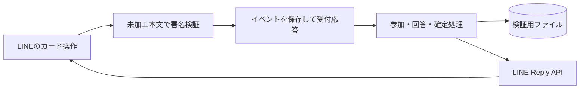

# LINE 日程調整Bot：トーク内で回答する検証版

別ページを開かず、LINEグループで候補3日へ○△×を回答し、集計・確定する最小版です。
候補は設定タイムゾーンの「開始日の翌日から3日」であり、Googleの予定やAIから算出していません。
Android・Slack・カレンダー連携・本番Base44接続は含みません。

## まずローカルで確認

Node.js 22以上が必要です。追加パッケージのインストールは不要です。

```powershell
cd 'C:\Users\sukiy\Documents\develop\sd_2602\line-schedule-bot'
node --test
node scripts/demo.js
node scripts/webhook-smoke.js
```

デモが出すJSONはLINE Flex Message Simulatorのバブル定義として確認できます。
https://developers.line.biz/flex-simulator/

`webhook-smoke.js`は`.env`を使わず、PC内にWebhook受付と模擬LINE送信先を一時起動します。
署名付きの「日程調整」、参加、○回答をHTTPで送り、返信が模擬送信先まで届くことを確認します。
不正署名の拒否・Webhook再送の重複排除・保存後の再読込も確認します。
実際のLINEへの送信はありません。テスト終了時に両サーバーを停止します。
テスト結果と架空データは`data/webhook-smoke/run-*/`へ保存し、本番用`data/state.json`とは分けます。
この確認はローカルHTTPであり、公開HTTPS・実LINE接続の確認ではありません。

## LINEアカウントを準備

1. LINE公式アカウントを新規作成します。
2. LINE Official Account Managerで、そのアカウントのMessaging APIを有効化します。
3. LINE Developers Consoleで対応するMessaging APIチャネルを開きます。
4. Channel secretとChannel access tokenを取得します。チャットやGitに貼らないでください。
5. Messaging API設定で「Allow bot to join group chats」を有効化します。
6. 検証中の二重返信を防ぐため、公式アカウント側の応答メッセージ・あいさつメッセージを無効化します。

公式手順：https://developers.line.biz/en/docs/messaging-api/getting-started/

## 接続設定・起動

```powershell
Copy-Item .env.example .env
```

`.env`の`LINE_CHANNEL_SECRET`と`LINE_CHANNEL_ACCESS_TOKEN`を自分の環境で記入してください。
`.env`は共有しません。`APP_TIME_ZONE`の初期値は`Asia/Tokyo`です。必要なら`Asia/Seoul`などへ変更できます。

```powershell
node --env-file=.env src/server.js
```

初期状態ではPC内の`http://127.0.0.1:3000`で待ち受けます。
`GET /health`は起動確認、`POST /webhook`はLINE専用受付です。
LINEからlocalhostへは接続できません。実機テストにはHTTPSトンネル、またはHTTPSで公開された常時稼働サーバーが別途必要です。
この作業ではトンネルや公開環境は作成していません。公開サーバーで直接受ける場合は必要に応じて`HOST=0.0.0.0`を設定します。

HTTPSのURLが決まったら、LINEのWebhook URLへ`https://あなたのホスト/webhook`を設定し、Verify後、Use webhookを有効化します。
署名付きの空イベント配列にも200で応答します。

## 実機の確認手順

1. 検証用グループにBotと人間2人を入れます。1グループへ追加できる公式アカウントは1つです。
2. 作成者が「日程調整」と送信します。作成者は参加者1になります。
3. もう1人がカードの「参加する」を押します。参加者2になります。
4. 各自が日付ごとの○△×を選びます。同じ日を選び直すと上書きされます。
5. 「最新の集計を表示」または「集計」という送信で確認します。
6. 作成者が「この日の確定内容を確認」→「この日で確定する」を押します。

操作後は最新カードが新しいメッセージとしてグループ全員へ返信されます。以前のカードの見た目は更新しません。
確定は登録参加者2人以上・その日の未回答なし・×なしを条件とし、△も許可します。
確認後に回答や参加者が変わると再確認が必要です。確定後の古いボタンは保存状態の変更を拒否します。
最大4人、1グループ1進行中案件、開始から24時間で期限切れです。
グループの全メンバーを自動登録・取得しません。「全登録参加者」と「グループ全員」は異なります。
通常の会話には反応せず、本文を保存しません。表示名を取得せず「参加者1〜4」を使用します。

## 構成と保存

- `src/domain.js`：参加・回答・集計・確定の状態遷移。
- `src/cards.js`：Flex Messageの表示とPostbackデータ。
- `src/service.js`：署名検証、Webhook重複排除、LINEへの返信。
- `src/store.js`：検証用のファイル保存。別の保存先へ差し替える境界。
- `src/server.js`：HTTP受付と保存済みキューの処理。



状態・受信イベントは`data/state.json`へ保存されます。ユーザーID・グループID・回答・処理待ちの返信トークンを含むため、公開・Gitへの追加・成果物への同梱はしません。
これは単一プロセスのローカル検証用です。複数サーバー・サーバーレス・共有ファイルでの運用には対応しません。
本番の保存先は既存方針どおりBase44内蔵DBを検討し、原子的な回答更新・イベント一意性・競合制御を検証してからアダプターを実装します。現時点では未接続です。

## 失敗・再送について

LINE署名を検証してから処理し、WebhookイベントIDで同じ操作の二重適用を防ぎます。
受信を永続化した後に受付を返し、LINEへの返信は非同期です。再起動時には保存済みの未処理キューを読みます。
返信失敗時は状態を`delivery_unknown`として記録し、勝手にPushで再送しません。
回答が保存されたのに返信が見えない場合は「集計」で確認します。送信と保存の間のクラッシュでは厳密な一回限りの配信は保証しません。
期限切れの返信トークンでは返せないため、長時間停止後も同様です。
保存データの自動削除・バックアップ・利用者向け削除機能は未実装です。試用終了後、サーバーを停止して検証用`data`を適切に削除してください。

## 未実装と次の検証

- LINE公式アカウント作成、トークン設定、HTTPS公開、実際のLINEでの表示・送受信。
- 本番Base44保存、Googleカレンダー、本人紐付け、候補推薦。
- 作成者以外のプロフィール表示、参加者の退出・候補日の編集、複数案件の同時進行。

まず実機で2人の回答から確定までを確認し、使いやすさを判断します。カレンダー推薦より先にこの導線を検証するための版です。
